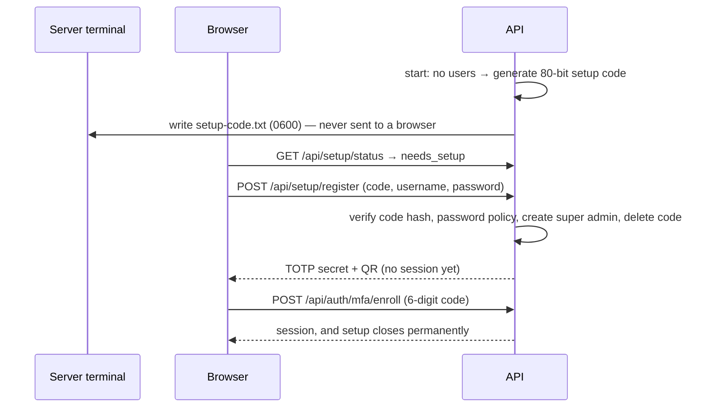
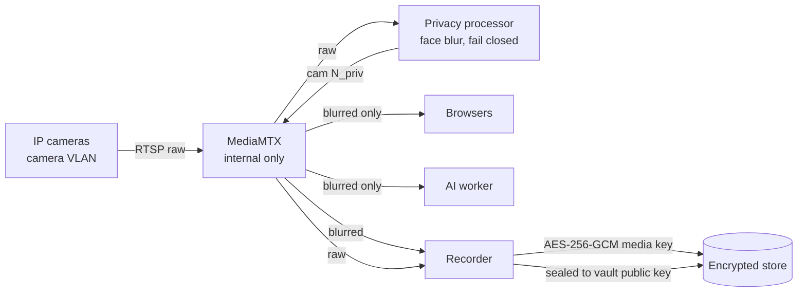

# Sentinel Attend — secure CCTV attendance with data privacy and data protection

Face-based attendance for colleges and campuses that proves a **live person** was present, while every face in every
video stays **blurred by default** and identifying anyone needs a **super admin's approval with MFA and a vault
passphrase**. It runs on your own hardware (a laptop for a pilot, a server for 500 cameras), CPU only, with no
cloud dependency.

> **Status: pilot-ready MVP, not certified.** See [Test status](#test-status) for exactly what has and has not been
> executed, and [Limits](#limits-stated-plainly) before using it for decisions that affect students' records.

**Contents:**
[What it does](#what-it-does) ·
[Quick start](#quick-start-laptop) ·
[Accounts and roles](#accounts-roles-and-first-run-setup) ·
[Privacy model](#privacy-model) ·
[Liveness](#liveness-and-anti-spoofing) ·
[Cryptography](#cryptography-and-keys) ·
[Security architecture](#security-architecture) ·
[Deployment](#production-deployment-docker) ·
[Configuration](#configuration-reference) ·
[Operations](#operations-runbook) ·
[Testing](#testing) ·
[Repository layout](#repository-layout) ·
[Compliance](#compliance-india-dpdp-act-2023) ·
[Limits](#limits-stated-plainly) ·
[Licences](#licences)

---

## What it does

| Area | Capability |
|---|---|
| **Attendance** | Kiosk check-in with a random head-movement challenge; passive CCTV attendance points; late cut-off; review queue for CCTV sightings without liveness proof; manual marking with reason; per-department and per-section views; CSV export |
| **Liveness** | Active challenge (12 random 3-move sequences) + MiniFASNetV2-SE texture anti-spoof model on every frame + identity-consistency and continuity checks |
| **Privacy** | Server-side face blur before video reaches any viewer, the AI worker or the recorder; fail-closed whole-frame blur; one-person selective unblur, watermarked, expiring after 15 minutes |
| **Data protection** | AES-256-GCM for blurred media and face templates; raw footage sealed to an offline-protected X25519 vault key; nothing plaintext on disk |
| **Accountability** | Every export, unblur request, approval, view, failed MFA and privileged change raises a security alert (console, SMS, WhatsApp, email) to admins and super admins; full audit log |
| **Accounts** | No built-in login; first super admin via a one-time local setup code; everyone else by single-use invitation; mandatory TOTP MFA |
| **Video management** | Live wall (1–25 tiles, WebRTC with LL-HLS fallback), encrypted playback, events, rules, zones, PTZ, IR switching, SMS/WhatsApp/siren alerts, ONVIF discovery |
| **Console** | 3D glass interface, dark and light themes, command palette (Ctrl K), keyboard and screen-reader support, phone layout |

## Quick start (laptop)

Prerequisite: **Python 3.10–3.14** from python.org.

```bash
git clone https://github.com/<you>/secure-cctv-attendance.git
cd secure-cctv-attendance
python run.py            # Windows: py run.py
```

The launcher builds a private virtualenv, downloads MediaMTX and the face models (each checked against a pinned
SHA-256), installs ffmpeg if missing, generates fresh keys in your local data folder, starts every service on
`127.0.0.1` and opens `http://127.0.0.1:8090`.

**First run.** No account exists, so the terminal shows a one-time setup code:

```
FIRST-RUN SETUP — no accounts exist yet.
  1. Open the console and choose "Set up this system".
  2. Enter this one-time setup code:   7QK2-M4XD-P9TB-LW3H
  3. Create the super admin account and scan the MFA QR code.
```

The console walks through four steps: setup code → your account → authenticator → encryption vault (optional at
this point, required before anything can ever be unblurred). Store the vault **recovery code** offline.

Useful launcher options (remembered between runs):

| Option | Effect |
|---|---|
| `--simulate 8` | 8 synthetic cameras for a load demo |
| `--videos <folder>` | Every video in the folder becomes a looping, recorded camera |
| `--webcam [device]` | Use the laptop camera |
| `--retention-hours 12` | Recording retention (default 6 h) |
| `--int8-detector` | Faster quantised face detector (same recall on our test set; off by default because blur must never miss a face) |
| `--setup-ai` | Export a YOLO object detector (AGPL weights; evaluation only) |
| `--selftest [--test-faces <folder>]` | Run the full test suite and open the HTML report |
| `--reset` | Wipe local data (asks for confirmation) |

Data lives outside the project (never in OneDrive or other synced folders):
Windows `%USERPROFILE%\SentinelAttend`, macOS `~/Library/Application Support/SentinelAttend`,
Linux `~/.local/share/SentinelAttend` (override with `VMS_HOME`).

## Accounts, roles and first-run setup

### No default credentials

The repository and the installers contain **no usernames, passwords, tokens or keys**. Every secret is generated on
first start in the local data folder (or in your `.env` for Docker), and a pre-push scanner
(`scripts/secret_scan.py`, test HD-14) blocks accidental commits.



Why a code at all: a "first visitor becomes admin" screen lets anyone who reaches the page first take over the
system. The code proves physical or shell access to the server. Ten wrong codes rotate it; requests are rate limited.

### Invitations (everyone else)

| Who | Can invite |
|---|---|
| Super admin | kiosk, viewer, operator, **admin, super admin** |
| Admin | kiosk, viewer, operator |
| Others | nobody |

An invitation is a single-use link (256-bit token, stored only as a SHA-256 hash, valid 24 h to 7 days). The person
chooses their own username and password and must enrol MFA before any session exists. Privileged invitations and
their redemption alert every super admin. **Password resets** use the same kind of link: the old password stops
working immediately, every session is revoked, and nobody but the user learns the new password.

Password policy (setup, registration, reset, change): 12+ characters, not containing the username, not a common
password, not repetitive, and at least three character classes if shorter than 16 characters. Hashing is Argon2id
(64 MiB, t=3, p=4).

### Role matrix

| Capability | Kiosk | Viewer | Operator | Admin | Super admin |
|---|:-:|:-:|:-:|:-:|:-:|
| Kiosk check-in screen | ✓ | | ✓ | ✓ | ✓ |
| Live wall and playback (blurred) | | ✓ | ✓ | ✓ | ✓ |
| PTZ, IR, alarm, acknowledge events | | | ✓ | ✓ | ✓ |
| Attendance, people, request an unblur | | | ✓ | ✓ | ✓ |
| Review / manual attendance, CSV export | | | | ✓ | ✓ |
| Cameras, rules, anti-spoof settings | | | | ✓ | ✓ |
| Invite kiosk / viewer / operator | | | | ✓ | ✓ |
| Manage admins and super admins | | | | | ✓ |
| Approve unblur (MFA + vault passphrase) | | | | | ✓ |
| Export video, live snapshots | | | | | ✓ |
| Create / rotate the encryption vault | | | | | ✓ |

The last super admin cannot be demoted, disabled or deleted.

## Privacy model



| Guardrail | Enforcement |
|---|---|
| Faces blurred for everyone | The media server's auth hook only lets viewers read `_priv` paths. Blur: 4-cell pixelation + Gaussian smoothing; tested so the recogniser cannot re-identify blurred faces (similarity ≤ 0.34 vs threshold 0.42; 0 of 305 blurred faces re-detected). If detection fails on a frame, the whole frame is blurred. |
| Unblur needs two people | An operator or admin requests it with a reason; a super admin approves with a fresh TOTP code **and** the vault passphrase. Only the requested person is revealed; everyone else stays blurred. |
| Unblurred results expire | Watermarked with request number, viewer and time; view-only; deleted after 15 minutes. |
| Export is super admin only | Fresh MFA + reason; watermarked; every attempt (allowed or denied) is alerted. |
| Minimal biometric data | Only encrypted 128-d face templates are kept; enrolment photos are discarded; consent references are required; erasure on withdrawal. |

## Liveness and anti-spoofing

Two independent layers, both required at the kiosk:

1. **Active challenge**: look straight, then three random moves (left / right / up, no immediate repeats → 12
   sequences) at 8 fps. A flat photo or screen cannot change its landmark geometry the way a turning head does;
   intermediate-pose continuity rejects photo swaps, and identity consistency rejects person swaps mid-challenge.
2. **Texture model**: MiniFASNetV2-SE from [suriAI/face-antispoof-onnx](https://github.com/suriAI/face-antispoof-onnx)
   (Apache-2.0, release 98.20, FP32 + INT8 vendored with pinned SHA-256). Its runtime is ported exactly: 1.5× square
   reflect-padded crop, letterbox to 128 px, logit-difference threshold (0.5 balanced, 0.8 high security), faces ≥ 64 px,
   3–5 consecutive real frames, quality gates for dark, backlit and blurred faces. Missing or tampered model → fails closed.

CCTV attendance requires natural head movement **and** the texture check; otherwise the sighting goes to the review
queue instead of marking the person present.

## Cryptography and keys

| Key | Algorithm | Protects | Held where |
|---|---|---|---|
| Media key | AES-256-GCM, chunked STREAM construction (1 MiB, header as AAD, last-chunk flag) | Blurred recordings, snapshots, attendance images, face templates | Server (`.env` / local `secrets.json`) |
| Vault key pair | X25519 + HKDF-SHA256 + AES-256-GCM (ECIES-style sealing) | Raw footage and raw face crops | Public key on server; private key **only** wrapped by Argon2id (256 MiB, t=3, p=4) of the passphrase and by a 160-bit offline recovery code |
| Fernet key | AES-128-CBC + HMAC-SHA256 | Camera URLs and passwords, TOTP secrets | Server |
| Session key | HMAC-SHA256 JWT | 30-min idle / 12-h absolute sessions (HttpOnly, SameSite=Strict cookie, CSRF header, server-side revocation) | Server |
| Internal token | 256-bit shared secret | API ↔ media server ↔ workers | Server, internal network only |
| Setup / invitation tokens | 80-bit / 256-bit random, SHA-256 at rest | Account creation | Terminal / the invitee |

Tampering, truncation, reordering and splicing of encrypted files are detected (tests CR-01…CR-17).

## Security architecture

- **Zero ingress.** Nothing listens on a public interface: the console binds to `127.0.0.1`, the LAN or a Tailscale
  address. Remote access is outbound only (Tailscale, or Cloudflare Tunnel + Access). Cameras sit on a VLAN with no
  internet route. Search engines like Shodan have nothing to index.
- **Browser hardening.** Strict CSP (no inline script), `frame-ancestors 'none'`, `nosniff`, `no-referrer`,
  `noindex`, camera permission limited to the kiosk origin; all dynamic text escaped (stored-XSS tests UI-08).
- **Input hardening.** Image dimensions checked before decoding (decompression bombs), 64 MiB request cap,
  ASCII-only single-use TOTP codes, CSV formula neutralisation, path confinement for media files.
- **Least privilege.** Containers run non-root, read-only, `cap_drop: ALL`, on internal networks.

The full threat model and residual risks are in [`docs/SECURITY.md`](docs/SECURITY.md).

## Production deployment (Docker)

```bash
./scripts/gen_secrets.sh > .env      # fresh random secrets; never commit .env
nano .env                            # VMS_BIND_IP, VMS_SITE_ADDRESS, VMS_WEBRTC_HOSTS, alert keys
docker compose up -d --build
docker compose exec api cat /data/store/setup-code.txt    # one-time code for the first super admin
```

Open `VMS_SITE_ADDRESS`, choose **Set up this system**, then add cameras (Cameras → Add → Probe ONVIF), create the
vault, add people with consent references and enrol them live.

Sizing guide for 500 cameras on CPU: decode is the bottleneck; plan roughly 60–100 analysed cameras per 16-core
worker host at 2 fps (benchmark on your hardware), 2–4 media nodes, and storage of
`cameras × bitrate × retention` (500 × 2 Mbit/s × 14 days ≈ 150 TB).

## Configuration reference

All settings are `VMS_*` environment variables (`.env.example` lists them). The most important:

| Variable | Default | Purpose |
|---|---|---|
| `VMS_SECRET_KEY`, `VMS_FERNET_KEY`, `VMS_INTERNAL_TOKEN`, `VMS_MEDIA_KEY` | — (required) | Generated by `gen_secrets.sh` or the launcher |
| `VMS_BIND_IP` | `127.0.0.1` | Interface the console binds to |
| `VMS_SETUP_CODE_FILE` | `<data>/setup-code.txt` | Where the first-run code is written (0600) |
| `VMS_INVITE_HOURS` | `72` | Default invitation lifetime |
| `VMS_SESSION_MINUTES` / `VMS_SESSION_MAX_HOURS` | `30` / `12` | Idle and absolute session limits |
| `VMS_UNBLUR_TTL_MINUTES` | `15` | Lifetime of an unblurred result |
| `VMS_ATTENDANCE_MATCH_THRESHOLD` / `_MARGIN` | `0.42` / `0.06` | Face match decision |
| `VMS_RECORDING_RETENTION_HOURS` | `720` | Encrypted recording retention |
| `VMS_TWILIO_*`, `VMS_WA_*`, `VMS_SMTP_*` | empty | SMS, WhatsApp and email for alerts |

## Operations runbook

| Task | How |
|---|---|
| Add staff | Users → Invite someone → send the link over a trusted channel |
| Someone forgot their password | Users → Send reset link (their sessions end immediately) |
| Lost authenticator | Users → Reset MFA; they enrol again at next sign-in |
| Vault passphrase lost | Privacy → Encryption vault → Change passphrase, using the offline recovery code |
| Both passphrase and recovery code lost | Sealed raw footage is unrecoverable by design; blurred footage remains |
| Consent withdrawn | People → Erase → "biometrics" (template only) or "all" |
| Backup | Database + store volume + `.env`/`secrets.json`; keep the recovery code separate from backups |
| Before every push | `python scripts/secret_scan.py` |

## Testing

```bash
python run.py --selftest --test-faces <folder of consented photos>
```

| Prefix | Area | Type |
|---|---|---|
| HD | MFA, password policy, setup codes, CSV safety, uploads, media-server policy, repository secret scan | Cyber |
| CR | Encryption and vault: tamper, truncation, splice, wrong key | Cyber |
| AS | Anti-spoof model port, quality gates, FP32 vs INT8, benchmark | Functional |
| FE / LV | Recognition, blur irreversibility, selective unblur; photo, screen, swap and replay attacks | Functional / Abuse |
| MT / PL | Media handling; real MediaMTX + privacy processor + encrypted recorder end to end | Functional / Cyber |
| FN / AB / CY | API: setup, invitations, resets, attendance, unblur, export; privilege escalation, brute force, IDOR, CSRF, injection, token tampering | Functional / Abuse / Cyber |
| UI | Roles, setup wizard, invitation and reset screens, XSS, CSP, keyboard, accessibility, phone to laptop widths | Functional |

### Test status

Latest run: GitHub Actions on a clean Ubuntu 24.04 runner, every suite, on the commit merged to `main`.

| Suite | Tests | Passed | Failed | Skipped |
|---|---:|---:|---:|---:|
| HD, CR (security helpers, encryption) | 34 | 34 | 0 | 0 |
| AS, FE, LV, MT (anti-spoof, recognition, liveness, media) | 76 | 56 | 0 | 20 |
| PL (end to end with real MediaMTX) | 11 | 0 | 0 | 11 |
| FN, AB, CY (API functional, abuse, cyber) | 72 | 72 | 0 | 0 |
| UI (console in headless Chromium) | 27 | 27 | 0 | 0 |
| **Total** | **220** | **189** | **0** | **31** |

**Pass rate of executed tests: 189 / 189 (100%).** The 31 skipped tests need photos of consenting people
(`--test-faces`), which are deliberately not stored in this repository. They were executed in the build environment
with such photos: all passed, except 4 expected failures that document a known limit (the texture model alone
misses simulated prints and low-resolution recaptures; the head-movement challenge blocks them). Run them on your
machine with `python run.py --selftest --test-faces <folder>`.

Every push runs the secret scan, a JavaScript syntax check and all suites; the HTML report is attached to each
run as the `test-report` artifact. 27 product defects found by these tests are fixed and listed, with root cause
and fix, in `tests/defects.json`.

## Repository layout

```
api/app/            FastAPI application (auth, setup + invitations, attendance, privacy, internal hooks)
shared/             crypto (vault, streaming AES-GCM), face engine, anti-spoof runtime, media tools
worker/             AI detection, privacy processor (blur), encrypted recorder
web/                console: index.html, css/glass.css, js/app.js, js/campus.js, js/fx.js
models/antispoof/   MiniFASNetV2-SE FP32 + INT8, YuNet INT8, Apache-2.0 licence, source commit
tests/              pytest suites, mock API for UI tests, defect register, HTML report generator
scripts/            secret generation, model export, pre-push secret scan
docs/               security design, threat model, test report
run.py              single-file installer and launcher (Windows, macOS, Linux)
```

## Compliance (India, DPDP Act 2023)

Biometric attendance needs informed consent and a stated purpose, verifiable parental consent for under-18s, a
non-biometric alternative for anyone who declines, retention limits and erasure on withdrawal. The system enforces
consent references (and guardian consent for minors) at enrolment and provides erasure; you still need signage, a
privacy notice, a retention policy and a data protection impact assessment. Commercial SMS needs TRAI DLT
registration; WhatsApp alerts need an approved template.

## Limits, stated plainly

- RGB liveness does not stop high-quality silicone masks or a live deepfake injected through a virtual camera. For
  high-stakes use, add IR or depth cameras and an ISO/IEC 30107-3 certified PAD component, and supervise kiosks.
- Blur depends on face detection; very small or heavily occluded faces can be missed for a frame (persistence and
  box expansion reduce this).
- View-only cannot stop someone filming a screen; the watermark makes such leaks attributable.
- A compromised server sees live raw video while it is running; sealed raw footage stays protected.
- Laptop mode suits pilots of about 4–8 cameras.

## Licences

Original code: GNU General Public License v2.0 (`LICENSE`). MiniFASNetV2-SE models: Apache-2.0 (suriAI). YuNet: MIT; SFace: Apache-2.0 (OpenCV
Zoo). MediaMTX: MIT. Ultralytics YOLO weights are AGPL-3.0 and are not shipped; use a licensed detector commercially.
